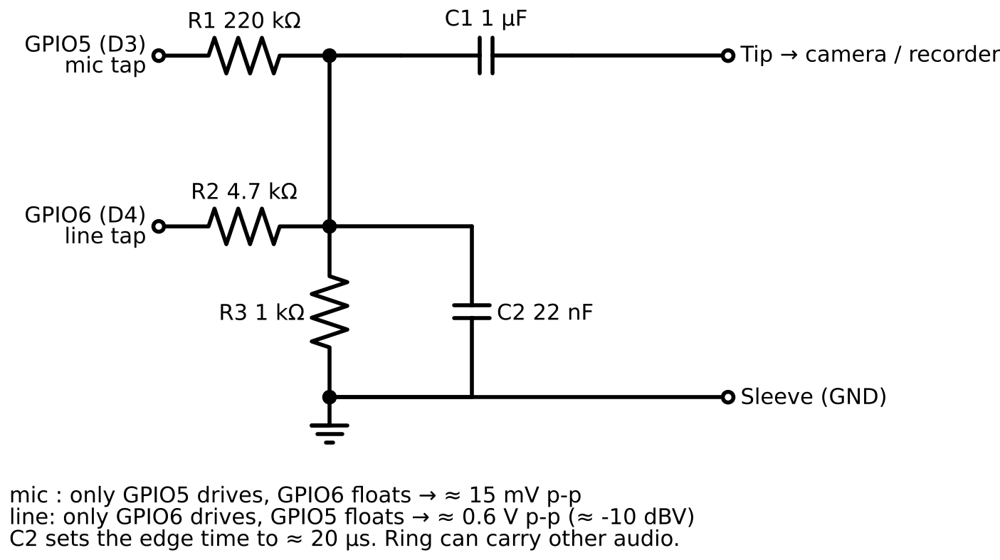
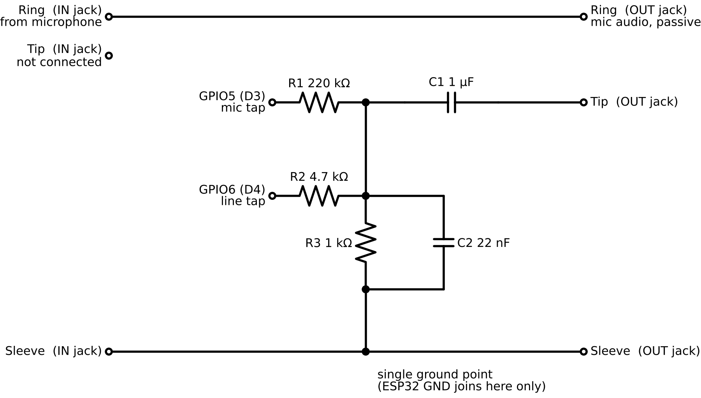

# 硬體

## 板子

| 用途 | 建議 | 備註 |
|---|---|---|
| node | **Seeed XIAO ESP32C3** | 內建 LiPo 充電、附 U.FL 外接天線、有溫度感測器 |
| node（替代） | XIAO ESP32C6 / XIAO ESP32S3 | 都有溫度感測器；同樣只用 2.4 GHz |
| master（ESP-NOW 模式） | 任何 ESP32（例：M5StickC Plus2） | 一直開著無線電，請接 USB 或行動電源 |

原版 ESP32 沒有可用的內建溫度感測器，當 node 時會自動關閉溫度補償。

## 電池（估計值，請實測）

| 狀態 | 電流 |
|---|---|
| 自己跑（CPU 80 MHz + RMT） | 約 15 mA |
| 對時視窗（3 s / 10 min，平均） | 約 0.4 mA |
| 雜項 | 約 0.5 mA |
| **合計** | **約 16 mA** |

可用時數 ≈ 容量 × 0.85 ÷ 16 mA → 500 mAh 約 26 h，**1000 mAh 約 53 h（建議）**。

## LTC 輸出接線

GPIO 輸出 0 / 3.3 V 方波。相機要 mic level，錄音機要 line level，所以要衰減，並且一定要**隔直流**（相機 mic 孔常帶 2–5 V 的 plug-in power）。

### mic / line 由軟體切換（建議接法）

| 元件 | 值 | 作用 |
|---|---|---|
| R1 | 220 kΩ | mic 抽頭（GPIO5 / D3） |
| R2 | 4.7 kΩ | line 抽頭（GPIO6 / D4） |
| R3 | 1 kΩ | 下拉，決定輸出阻抗（約 1 kΩ） |
| C2 | 22 nF | 柔化邊緣，上升時間約 20 µs（接近 SMPTE 建議的 25 µs） |
| C1 | 1 µF | 隔直流，擋住相機的 plug-in power |

- 軟體一次只讓一隻腳輸出 LTC，另一隻腳設成高阻抗（輸入模式）。浮空的那顆電阻沒有電流，不影響輸出。
  - **mic**：約 15 mV p-p，給相機的 mic 輸入。
  - **line**：約 0.6 V p-p（約 -10 dBV），給錄音機或相機的 line 輸入。
- 切換方式：混合版 / online 版在 HA 或網頁的「Output Level」下拉選單；純省電版用 YAML 的 `output_level:`。每台各自記在 flash，**不會同步**（相機和錄音機要的不一樣）。
- 切換時 LTC 會中斷約 0.1 秒，請在架設時切，不要在錄影中切。
- 相機上把該聲道錄音電平調到峰值約 -20 dBFS，**關掉 AGC / 自動電平**。LTC 只放一個聲道，另一聲道可以留給機頭收音。
- 只需要一種電平時，只接那一顆電阻，YAML 裡不設 `line_pin` 即可（只接 R1 = 固定 mic）。
- 圖由 [`tools/draw_schematics.py`](../tools/draw_schematics.py)（schemdraw）產生，改電路請改腳本再重畫。

### 麥克風直通（3.5 mm TRS 進 → 換掉 L → 出）

像 Tentacle Sync E 一樣：外接麥克風插進 node 的輸入孔，右聲道（Ring）和地（Sleeve）**用銅線直接穿過**，左聲道（Tip）換成 LTC。

重點：

- 相機的 plug-in power 會照常經過 Ring 供應給麥克風；Tip 上有 1 µF 隔直電容擋著。
- 麥克風路徑上**完全沒有主動元件**，ESP32 壞掉或沒電時，麥克風照樣能錄。
- **省電模式下 node 只接收、從不發射**：被動掃描、被動收 beacon，ESP-NOW 設定也是被動收。所以不會有手機那種「嗒嗒嗒」的發射干擾。⚠️ 混合版在**上線期間**（開機後 30 分鐘、插著 USB 時）會連 Wi-Fi 並發射，錄音前請確認已進省電模式（HA 的 Sync State 不再顯示 online），或使用純省電版。剩下可能的雜訊來源：
  1. **對時視窗的接收電流**（15 → 85 mA 的跳變）：電池浮接，而且只在一點接地，電流不會流過 Sleeve，所以理論上影響很小。如果實測聽得到，就改成 `resync_interval: 0s`，校正完之後無線電就不會再開。
  2. **LTC 串音到 R 聲道**：LTC 電平開低（相機上約 -30 到 -20 dBFS 就夠解碼），加上 C2（22 nF）讓邊緣變緩、減少高頻諧波。
  3. **CPU 的時脈雜訊**：音訊線盡量短，用隔離線；必要時在輸出線套一顆磁環。
- 外殼用塑膠（天線要露出來）；需要的話，在音訊那一段內側貼銅箔，並接到 Sleeve。

**驗證方法**：麥克風接好但不出聲，錄 15 分鐘，中間按一次 `sync_now()` 強制對時。比較 R 聲道在 (a) node 關機、(b) 自己跑、(c) 對時視窗中這三段的底噪。如果 (b)、(c) 都沒有高過麥克風本身的底噪，就可以正式使用。

### 雜訊與接地

- 盡量讓 node **用自己的電池**。從相機 USB / D-tap 取電同時又接音訊，容易形成接地迴路，錄進嗡嗡聲或數位雜訊。
- 必須共用電源時，在音訊路徑串一顆 1:1 音訊隔離變壓器。
- 天線不要被相機機身或金屬兔籠擋住；XIAO 的 U.FL 天線可以貼在兔籠外側。

## 腳位（範例 YAML）

| XIAO 腳位 | GPIO | 用途 |
|---|---|---|
| D3 | GPIO5 | LTC 輸出（mic 抽頭，220 kΩ） |
| D4 | GPIO6 | LTC 輸出（line 抽頭，4.7 kΩ） |
| D2 | GPIO4 | 鎖定 LED（可選，經 330 Ω 接 LED 到 GND） |
| D1 | GPIO3 | PPS 驗證脈衝（可選） |

避免使用 strapping pin（C3 的 GPIO2、8、9）當 LTC 輸出。
