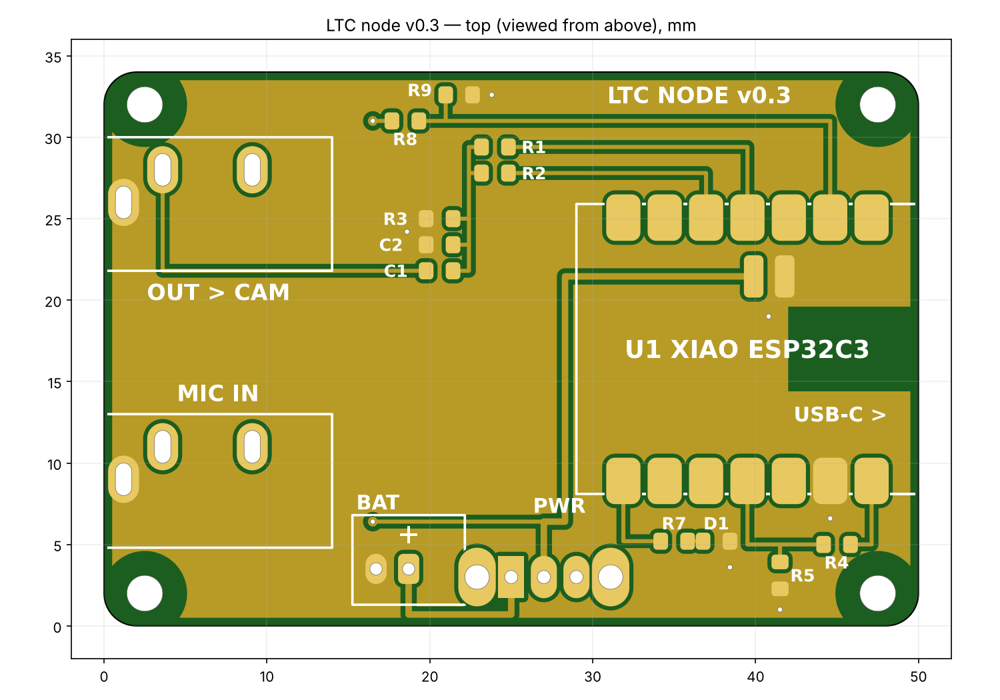
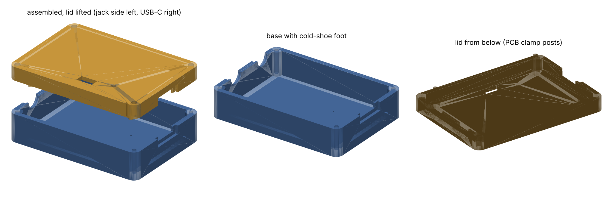

# 硬體：底板 PCB 與外殼

> ℹ️ **選用。** 功能測試先用 XIAO 加洞洞板接線即可（[docs/hardware.md](../docs/hardware.md)），測完再決定要不要打樣這塊底板與外殼。
>
> ⚠️ **尚未打樣、尚未實機驗證。** 檔案由程式產生，已通過自動設計檢查（間距、連通、Gerber 解析），但零件實際尺寸要你在下單前再對一次（見文末檢查清單）。第一批建議只打 5 片、先印一個外殼試裝。

## 內容

| 路徑 | 說明 |
|---|---|
| `pcb/ltc_node_pcb.py` | 產生 PCB 的程式（零件位置、走線、設計檢查都在這裡） |
| `pcb/out/ltc-node-pcb-gerber.zip` | **上傳 JLCPCB 用**：Gerber（銅、防焊、鋼網、絲印、外框）＋ PTH / NPTH 鑽孔檔 |
| `pcb/out/bom_jlcpcb.csv`、`cpl_jlcpcb.csv` | JLCPCB 代焊用的元件清單與座標檔（只含 0603 小零件） |
| `pcb/out/bom_handsolder.csv` | 自己焊的零件：XIAO、3.5 mm 插座、電池座、開關、電池、螺絲 |
| `pcb/out/preview_top.png`、`preview_bottom.png` | 板子正反面預覽 |
| `pcb/out/drc_report.txt` | 設計檢查結果（間距 ≥ 0.2 mm、每條線路連通） |
| `enclosure/ltc_node_enclosure.py` | 產生外殼的程式 |
| `enclosure/out/base.step`、`lid.step` | **STEP 實體檔**：可在 Fusion 360、FreeCAD、Onshape 編輯，也能直接上傳 JLC3DP |
| `enclosure/out/base.stl`、`lid.stl` | STL 網格（JLC3DP 建議的上傳格式，任何切片軟體都能開） |
| `enclosure/out/enclosure.3mf` | 兩件排好列印方向，給自己的 3D 印表機用 |

重新產生：`pip install shapely matplotlib gerbonara build123d trimesh`，然後執行兩支 `.py`。外殼用 build123d（OpenCascade 核心）建出實體，所以能輸出 STEP。

## 電路

- 板子 50 × 34 mm，雙層，1.6 mm。尺寸和 1000 mAh 電池（503450）一樣，電池墊在板子下面。
- **XIAO ESP32C3 直接貼焊**（郵票孔），底部的 VBAT / GND 焊盤也焊到底板，電池經底板接到 XIAO。
- 輸出級和麥克風直通：同 [docs/hardware.md](../docs/hardware.md)（R1 220k mic、R2 4.7k line、R3 1k、C2 22 nF、C1 1 µF）。
- 電池：JST-PH 2.0 → 滑動開關 → XIAO VBAT。**開關要在 ON 才能充電。**
- 電池電壓：VBAT ÷ 2（220k / 220k）→ GPIO3（ADC），HA 上顯示「Battery Voltage」。
- USB 供電偵測：5V ÷ 2（100k / 100k）→ GPIO10，混合版用來「插 USB 就保持上線」（YAML 裡解除註解即可）。
- 鎖定 LED：GPIO20 → 330 Ω → 紅色 LED。

| XIAO | GPIO | 用途 |
|---|---|---|
| D1 | GPIO3 | 電池電壓（ADC） |
| D3 | GPIO5 | LTC mic 抽頭 |
| D4 | GPIO6 | LTC line 抽頭 |
| D7 | GPIO20 | 鎖定 LED |
| D10 | GPIO10 | USB 供電偵測 |

根目錄三份 YAML 已經改成這個腳位。

## 在 JLCPCB 下單

1. 到 jlcpcb.com 上傳 `ltc-node-pcb-gerber.zip`，參數用預設即可（2 層、1.6 mm、HASL 或無鉛）。
2. 確認線上預覽：外框 50 × 34 mm、四角有 2.2 mm 孔、兩個插座位置有長圓孔。
3. 要代焊的話勾 **PCB Assembly**（Top side），上傳 `bom_jlcpcb.csv` 和 `cpl_jlcpcb.csv`。
   - 在零件位置預覽裡檢查 **D1（LED）的極性**和每顆零件的角度，不對就在網頁上旋轉。
   - C2（22 nF，C77571）可能是 Extended 零件，會多一筆換料費；不想多付可以自己焊或換成 Basic 的 10 nF + 10 nF。
4. 其他零件照 `bom_handsolder.csv` 自己買、自己焊。插座 SJ1-3533NG 和電池座 B2B-PH-K-S 在 LCSC 有貨；開關 OS102011MS2QN1 可在 DigiKey / Mouser 買。

## 焊接順序

1. （若沒代焊）0603 零件。
2. **XIAO**：先在底板 VBAT / GND 兩個焊盤上錫，放上 XIAO 對齊郵票孔，用熱風槍加熱讓底部焊盤熔接，再逐一焊兩側郵票孔。
3. 開關、電池座、兩個 3.5 mm 插座（插座的 GND 腳接在大面積銅箔上，烙鐵溫度調高一點）。
4. 接上 XIAO 附的 FPC 天線。
5. ⚠️ **電池的正負極**：JST-PH 電池的線序沒有統一標準。插之前用電錶確認電池紅線對到板子上的「+」。

## 外殼

- 尺寸約 57 × 41 × 17 mm（不含冷靴腳）。上下兩件，在插座和 USB-C 的中心線分開，所以 PCB 可以直接放進底座。
- 疊法：底座 → 電池（底面貼一層 0.5 mm 泡棉膠）→ PCB → 上蓋。上蓋的四根柱子會插進 PCB 的四個孔，把 PCB 壓在電池上。
- 4 顆 **M2 × 10 自攻螺絲**從上蓋鎖進底座角柱（螺絲頭露在上蓋表面；若做沉頭孔，角落牆會薄於 0.8 mm）。
- 上蓋：LED 透光孔（剪一段 1.75 mm 透明線材插進去當導光柱）、開關撥桿槽。
- 天線 FPC 貼在上蓋內側。
- 底部是標準冷靴腳，可以插相機熱靴。
- 自己印：PETG，0.2 mm 層高，底座開口朝上，上蓋頂面朝下，不需要支撐。
- **JLC3DP 代印**：上傳 `base.stl`、`lid.stl`（或 STEP）。主要牆厚 2 mm，最薄處（USB 和插座外側凹槽）0.8 mm，符合 JLC3DP「牆厚 > 1.2 mm、最薄 ≥ 0.8 mm」的要求。材料選尼龍或樹脂皆可；要鎖自攻螺絲的話，尼龍比較不容易裂。

## 下單前的檢查清單

- [ ] 在 JLCPCB 預覽或 KiCad 的 Gerber Viewer 打開 zip，量 XIAO 郵票孔間距（2.54 mm、兩排中心距 16.17 mm）。
- [ ] 3.5 mm 插座 SJ1-3533NG 的三個長圓孔位置對照 CUI 規格書。
- [ ] 開關、電池座實物和孔位比一下。
- [ ] 外殼先印一個，把電池、PCB 放進去試裝，確認插頭能插到底、USB-C 線插得進去、開關撥得到。
- [ ] 插座中心高度、開關撥桿高度是依規格書估計的（插座中心約在 PCB 上方 2.5 mm），試裝後若有偏差，改 `ltc_node_enclosure.py` 的 `Z_SPLIT`、`Z_CEILING` 後重新產生。
